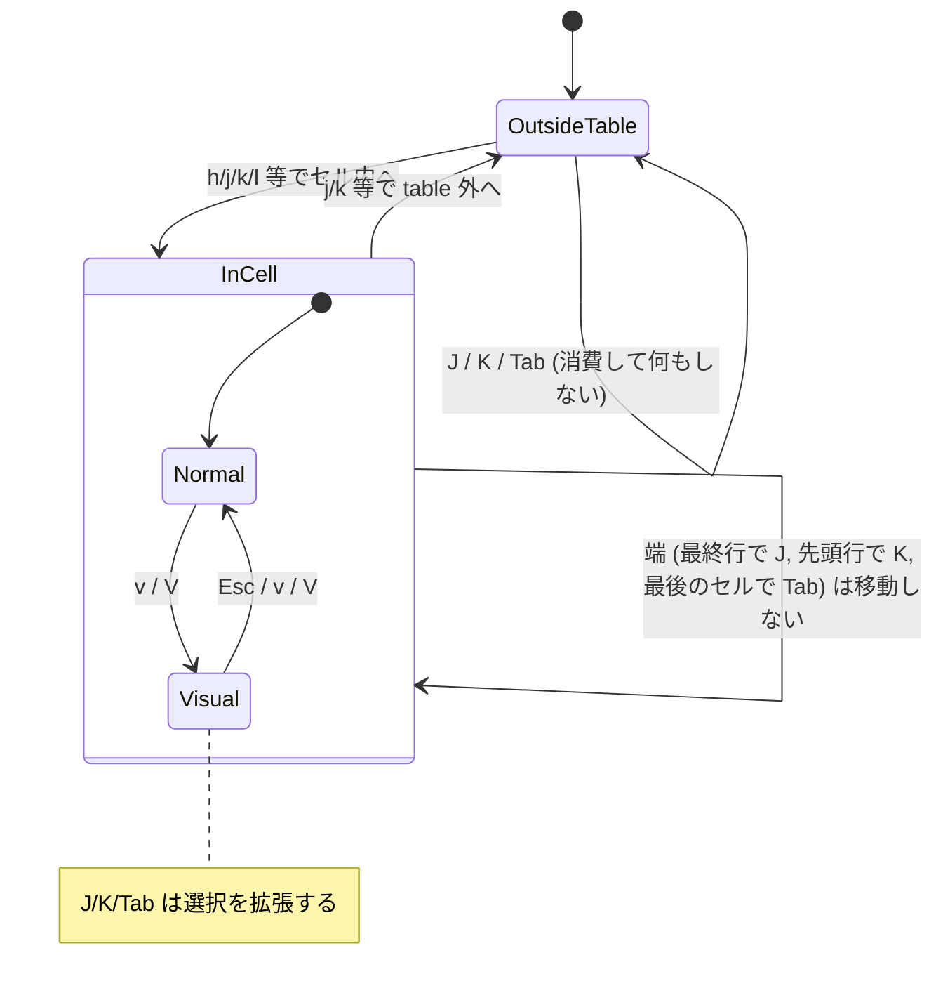
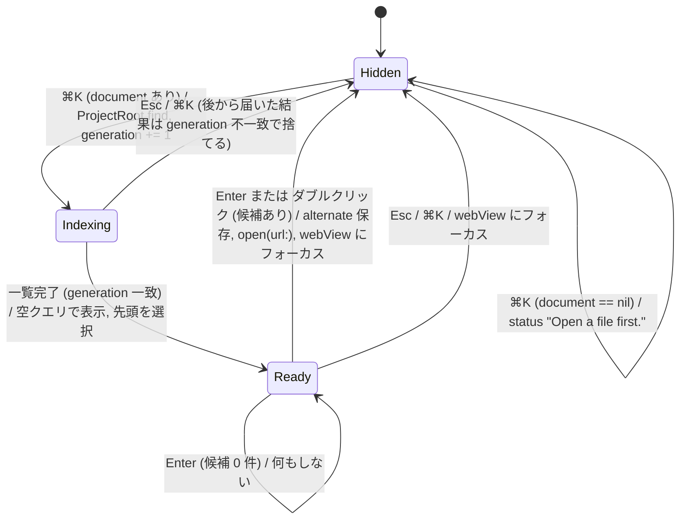

# 実装計画: Table 内移動 (J / K / Tab) と ⌘K Markdown ファインダー

2 つの機能は独立しているので、別々のコミット（できれば別 PR）にする。

- **A. Table 内移動**: `markdown_renderer.js` だけの変更
- **B. ⌘K Markdown ファインダー**: Native Swift (AppKit)。WebView には手を入れない

---

## A. Table 内移動

### 仕様

| キー | カーソルが table のセル (`th` / `td`) 内にあるとき | table の外 |
|---|---|---|
| `J` (Shift+j) | 1 つ下の行の**同じ列**のセル先頭へ移動。最終行なら何もしない | 何もしない（キーは消費する） |
| `K` (Shift+k) | 1 つ上の行の同じ列のセル先頭へ移動。先頭行（ヘッダー）なら何もしない | 何もしない（キーは消費する） |
| `Tab` | 次のセル先頭へ移動。行末なら次の行の最初のセルへ。最後のセルなら何もしない | 何もしない（キーは消費する） |

- ヘッダー行 (`thead` の `th`) も 1 行として扱う。`table.rows` / `row.rowIndex` / `cell.cellIndex` を使えば thead・tbody をまたいで扱える。
- 列数が足りない行では最終セルにクランプする（markdown-it は列を補完するので通常は起きない）。
- `v` / `V` モードでは既存の `move()` を通して選択を**拡張**する。通常モードでは移動するだけ。
- `Tab` は table の外でも `preventDefault` する。消費しないと WebKit のフォーカスが TOC のリンクやツールバーに移り、Vim キーが効かなくなるため。
- `Shift+Tab` はバインドしない（今回のスコープ外）。keydown で `event.key === "Tab" && event.shiftKey` のときは今までどおり何もしない。

### 実装 (`Sources/QuickMarkview/Resources/markdown_renderer.js`)

1. 定数 `TAB = "\t"` を追加する。keydown ハンドラで `event.key === "Tab" && !event.shiftKey` を `TAB` に変換する（今は `key.length !== 1` で弾かれている）。
2. ヘルパーを追加する（既存の `linkAtCaret()` と同じスタイルで）:
   ```js
   function cellAtCursor() {
     const [node] = mode === "V" ? cursor : caret();
     const element = node && (node.nodeType === 3 ? node.parentElement : node);
     return element && element.closest ? element.closest("th, td") : null;
   }

   function moveToCell(cell) {
     if (!cell) return;
     const target = document.createTreeWalker(cell, NodeFilter.SHOW_TEXT).nextNode() || cell;
     move((selection, alter) => alter === "extend" ? selection.extend(target, 0) : selection.collapse(target, 0));
   }

   function rowStep(step) {
     const cell = cellAtCursor();
     const row = cell && cell.closest("table").rows[cell.parentElement.rowIndex + step];
     if (row) moveToCell(row.cells[Math.min(cell.cellIndex, row.cells.length - 1)]);
   }

   function nextCell() {
     const cell = cellAtCursor();
     if (!cell) return;
     const row = cell.parentElement, below = row.closest("table").rows[row.rowIndex + 1];
     moveToCell(row.cells[cell.cellIndex + 1] || (below && below.cells[0]));
   }
   ```
   - V モードでは `caret()` が行末を返すので、`cursor` を見る必要がある（上の `cellAtCursor` のとおり）。
3. `bindings` に `J: () => rowStep(1)`, `K: () => rowStep(-1)`, `[TAB]: nextCell` を追加する。
4. **空セル対策**: 空セルにはテキストノードがないので、`collapse(cell, 0)` になる。`rectAt()` は要素ノードだと矩形が取れず、カーソルが非表示になる。`rectAt()` に「矩形が取れず、`node` が要素ノードなら `node.getBoundingClientRect()` を使う」フォールバックを足す。
5. 横に長い table は `display:block; overflow:auto` なので横スクロールになる。`drawCursor()` の `scrollIntoView({block: "nearest"})` は `#cursor`（body 直下）に対して動くので、table 内の横スクロールは追従しない。そこで `moveToCell` の後に `cell.scrollIntoView({block: "nearest", inline: "nearest"})` を呼ぶ。
6. README の Vim キー一覧に 3 行追加する:
   ```text
   J K         Move to the same column in the next / previous table row.
   <Tab>       Move to the next table cell.
   ```

### 状態遷移



### テスト (`Tests/QuickMarkviewTests/VimKeyTests.swift`)

既存の `loadViewer` と `press` を使う。`press` は `key` をそのまま `KeyboardEvent` に渡すので、`"J"` と `"Tab"` はそのまま使える。

フィクスチャ:
```markdown
| A | B | C |
|---|---|---|
| a1 | b1 | c1 |
| a2 |    | c2 |
```

- `testShiftJKMovesWithinTableColumn`: `B` のセルにカーソルを置き、`J` で `b1` → `J` で空セル（`closest('td').cellIndex == 1`、`#cursor` が表示されている）→ `J` は動かない → `K` `K` で `B`。selection メッセージの `lineStart` が行ごとに変わる（3 → 4）。
- `testTabMovesToNextCellAndWrapsRows`: `c1` で `Tab` → `a2`。最後のセル `c2` で `Tab` → 動かない。
- `testTableKeysAreConsumedOutsideTable`: 段落内で `J` / `Tab` の `dispatchEvent` が `false` を返し、カーソル位置が変わらない（`testUnboundKeysAreNotSwallowed` と同じ書き方）。
- `testVisualModeExtendsAcrossTableRows`: `v` → `J` で選択が `b1` のセル先頭まで伸び、`isCollapsed == 0`。
- `Shift+Tab` は消費されない: `new KeyboardEvent('keydown', {key: 'Tab', shiftKey: true, cancelable: true})` が `true` を返す。

### E2E 確認（ローカル、UI 操作）

1. `scripts/build-app.sh` → `open dist/QuickMarkview.app --args <fixture.md>`（上のフィクスチャに段落と横に長い 8 列の table を加えたもの）。
2. `j` で table に入り、`l` でヘッダー `B` に移動 → `J` を 3 回押す。カーソルが B 列を下に進み、最終行で止まることを目視で確認する。空セルでもカーソル矩形が見えること。
3. `K` で上に戻る。ヘッダーで止まる。
4. `Tab` を連打する。行をまたいで右 → 次の行の先頭へ進み、最後のセルで止まる。横に長い table で右端の列まで進むと横スクロールが追従する。
5. table の外で `Tab` を押しても、フォーカスがツールバーへ移らず `j`/`k` が効き続ける。
6. `v` → `J` → `Space a a`。リクエストパネルの `Lines:` が 2 行分の範囲になる。

---

## B. ⌘K Markdown ファインダー（Native Swift）

### 仕様

- ⌘K（View メニュー › **Go to Markdown File…**）でファインダーを開く。表示中にもう一度 ⌘K を押すと閉じる。
- **ルート決定**: 開いているドキュメントのディレクトリから親へたどり、`.git`（ディレクトリでもファイルでもよい。worktree は `.git` がファイル）、`.hg`、`.jj` のどれかがある最初のディレクトリをルートにする。見つからなければドキュメントのディレクトリをルートにする。ドキュメントが開かれていなければ、ステータスに `Open a file first.` を出して何もしない。
- **一覧**: ルート以下の Markdown ファイル。拡張子は `DocumentKind` と同じ `md, markdown, mdown, mkd` を使う。
  - ルートに `.git` がある場合: `git -C <root> ls-files -z --cached --others --exclude-standard` を使う（.gitignore を尊重し、`node_modules` や `.build` を自然に除外するため）。既存の `CommandRunner` を使い、タイムアウトは 5 秒。
  - それ以外、または git が失敗した場合: `FileManager.enumerator(at:includingPropertiesForKeys:options: [.skipsHiddenFiles, .skipsPackageDescendants])` を使い、`node_modules` を skip する。
  - どちらも上限は 20,000 件。
- **UI（Telescope 風）**: ウィンドウ中央上寄りに重ねるオーバーレイ（既存の `requestPanel` と同じ `NSVisualEffectView` / `.popover` / 角丸 10）。
  - 上に検索フィールド（`NSSearchField` ではなく `NSTextField`）。右端に `12 / 340` の件数を出す。
  - 下に結果リスト（`NSTableView` 1 列、view-based）。行はルートからの相対パスを表示する。ファイル名部分は通常色、ディレクトリ部分は `secondaryLabelColor` にし、マッチした文字は太字にする。
  - 幅はウィンドウの 60%、高さは 55%。
  - プレビューペインは今回のスコープ外。
- **キー操作**（フォーカスは常に検索フィールド）:
  | キー | 動作 |
  |---|---|
  | 文字入力 | ファジー絞り込み（入力ごとに同期的に再計算） |
  | `↓` / `Ctrl-N` | 次の候補 |
  | `↑` / `Ctrl-P` | 前の候補 |
  | `Enter` / 行ダブルクリック | 選択中のファイルを開いて閉じる |
  | `Esc` / `⌘K` | 閉じる |
  - `Ctrl-N` / `Ctrl-P` は AppKit の標準テキストバインディングで `moveDown:` / `moveUp:` になるので、`control(_:textView:doCommandBy:)` の中で `↑↓` と一緒に処理できる。
- **ファイルを開く**: `open(url:line: nil)` を呼び、開く前のファイルを `alternate` に入れる。これで `<C-^>` で戻れる。戻り先の行は JS に `window.quickMarkview.visibleLine()` を追加して `evaluateJavaScript` で取得する（関数本体は既存の `visibleLine()` を公開するだけ）。
- 閉じるときは必ず `makeFirstResponder(webView)` を呼び、Vim キーを戻す。
- リクエストパネルが開いているときに ⌘K を押したら、リクエストパネルを閉じてからファインダーを開く。
- `q` で閉じる処理は、検索フィールドがフォーカスを持っていれば効かない（フィールドエディタは `NSText` なので既存の `closesViewer` のままでよい）。

### ファジーマッチ（純粋関数、Core に置く）

`FuzzyMatcher.score(query:candidate:) -> Int?`
- 大文字小文字を区別しない**部分列マッチ**で、マッチしなければ `nil`。
- 加点: 連続してマッチ (+5)、単語境界 (`/ _ - .` の直後、または先頭) でのマッチ (+8)、ファイル名部分でのマッチ (+3)。
- 減点: 最初のマッチ位置 (-1/文字、最大 -10)。
- 絞り込み結果: スコアの降順 → パス長の昇順 → 辞書順。表示は最大 200 件。
- クエリが空: 開いているファイルを除き、相対パスの辞書順。
- 空白区切りのクエリ（`docs plan`）は、全トークンがそれぞれマッチすることを条件にし、スコアは合計する。

マッチした文字のハイライト用に、`FuzzyMatcher.match(query:candidate:) -> (score: Int, positions: [Int])?` を本体にして、`score` はそのラッパーにする。

### ファイル構成

| ファイル | 内容 |
|---|---|
| `Sources/QuickMarkview/Core.swift` | `DocumentKind.markdownExtensions` を `public static let` に出す。`ProjectRoot.find(from:) -> URL?`（マーカーは `[".git", ".hg", ".jj"]`）。`FuzzyMatcher`。 |
| `Sources/QuickMarkview/MarkdownFileIndex.swift`（新規） | `MarkdownFileIndex.list(root:runner:completion:)`: git を試し、だめなら FileManager にフォールバックする。結果はルートからの相対パス `[String]` をソートしたもの。`CommandRunning` を注入してテストで差し替えられるようにする。 |
| `Sources/QuickMarkview/FileFinder.swift`（新規） | `FileFinderView: NSVisualEffectView`。検索フィールド、テーブル、件数ラベル。`NSTableViewDataSource/Delegate` と `NSTextFieldDelegate`。外に出すのは `show(root:paths:)`, `onChoose: (URL) -> Void`, `onCancel: () -> Void` だけ。 |
| `Sources/QuickMarkview/App.swift` | `mainMenu()` の View メニューに `Go to Markdown File…` (⌘K → `ViewerViewController.toggleFileFinder(_:)`)。`loadView` に finder を追加（`requestPanel` と同じ重ね方）。`toggleFileFinder` で ルート決定 → インデックス作成 → 表示。 |
| `Sources/QuickMarkview/Resources/markdown_renderer.js` | `window.quickMarkview.visibleLine` を公開する。 |
| `README.md` | ⌘K の説明を ⌘L の記述の隣に 1 文追加。 |

### 状態遷移



- Indexing 中もパネルは表示し、リストの代わりに `Indexing…` を出す。検索フィールドには入力できる。結果が届いたら、その時点のクエリでフィルタする。
- 結果が 0 件なら `No Markdown files under <root>` を表示する。
- 一覧は ⌘K のたびに作り直す（キャッシュしない）。git ls-files は十分速く、ファイル追加に追従する方が単純なため。

### テスト

`Tests/QuickMarkviewTests/CoreTests.swift`（または新規 `FileFinderTests.swift`）:
- `testProjectRootFindsNearestMarker`: 一時ディレクトリに `a/.git/`（ディレクトリ）と `a/b/c/` を作り、`find(from: a/b/c)` が `a` を返す。`.git` がファイルの場合も同様。マーカーがなければ `nil`。
- `testFuzzyMatcherOrdersByQuality`:
  - `score("rdm", "README.md") != nil`、`score("xyz", "README.md") == nil`
  - `filter("plan", ["docs/plans/x.md", "src/p_l_a_n.md", "plan.md"])` の先頭が `plan.md`
  - 境界マッチが散らばったマッチより上に来る
  - 空白区切りの複数トークンが AND になる
  - 大文字小文字を区別しない、日本語ファイル名にもマッチする
  - `match` の `positions` が正しい
- `testMarkdownFileIndexUsesGitAndFiltersExtensions`: `CommandRunning` のスタブが `"a.md\0b.txt\0docs/c.markdown\0"` を返すと `["a.md", "docs/c.markdown"]` になる。
- `testMarkdownFileIndexFallsBackToFileSystem`: スタブが失敗を返す。一時ディレクトリに `x.md`, `.hidden/y.md`, `node_modules/z.md`, `sub/w.mdown` を作ると `["sub/w.mdown", "x.md"]` になる。
- `testMarkdownFileIndexRespectsGitignore`（実際の git を使う）: `git init` した一時ディレクトリに `.gitignore` で `ignored/` を指定し、`ignored/a.md` が出ないこと。`/usr/bin/git` がなければ `XCTSkip`。

`Tests/QuickMarkviewTests/WebKitSmokeTests.swift`:
- `testCommandKTogglesFileFinder`: `testCommandLTogglesSidebar` と同じ形で、⌘K のメニュー項目の action が `toggleFileFinder(_:)` であることを確認する。
- `testFileFinderKeyHandling`: `FileFinderView` を直接作り、`show(root:paths:)` → フィールドに文字を入れて `controlTextDidChange` を発火 → `doCommandBy(moveDown:)` → `insertNewline:` で `onChoose` に期待した URL が渡る。`cancelOperation:` で `onCancel` が呼ばれる。

### E2E 確認（ローカル、UI 操作）

準備: `scripts/build-app.sh`。このリポジトリ自体（README.md, Motivation.md, THIRD_PARTY_NOTICES.md, docs/plans/*.md, `.build` 配下に依存の md がある）を対象にする。

1. `open dist/QuickMarkview.app --args $PWD/README.md` → ⌘K。パネルが出て、件数が `.build` を含まない数になっていること（`git ls-files '*.md' | wc -l` + 未追跡の md と一致する）。
2. `thirdp` と入力 → 先頭が `THIRD_PARTY_NOTICES.md`、マッチ文字が太字になっている。
3. `Ctrl-N` / `↓` / `Ctrl-P` / `↑` で選択が動き、端で止まる。
4. `Enter` → 選ばれたファイルが表示され、ツールバーのパスが変わる。`j`/`k` がすぐ効く（フォーカスが webView に戻っている）。
5. `Ctrl-^` → README.md の元のスクロール位置に戻る。
6. ⌘K → `Esc` で閉じる。⌘K → ⌘K でも閉じる。閉じた後に `q` を押すとウィンドウが閉じる（フォーカスが戻っている）。
7. 検索フィールドに `q` を打てること（ウィンドウが閉じない）。
8. git 管理外のディレクトリ（`mkdir /tmp/qmv && touch /tmp/qmv/{a,b}.md`）の `a.md` を開いて ⌘K → `a.md`, `b.md` が出る。
9. `--resident` で起動し、ファイルを開いていない状態で ⌘K → ステータスに `Open a file first.` が出てパネルは出ない。
10. `Space a a` でリクエストパネルを開いた状態で ⌘K → リクエストパネルが閉じてファインダーが出る。

---

## 完了条件

- `swift test` がすべて通る（既存テストを含む）。
- 上の E2E 手順を A・B ともに実施し、結果を PR 本文に書く。
- コミットは A と B で分ける（Conventional Commits: `feat(viewer): ...`, `feat: ...`）。
